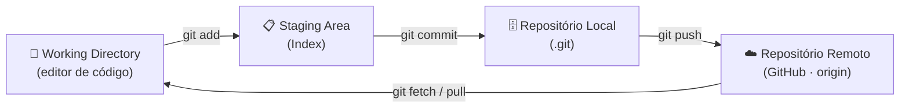
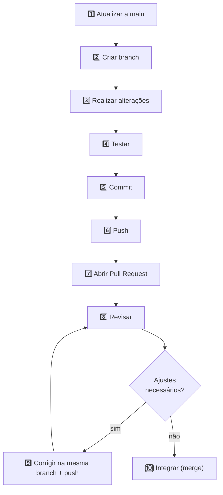
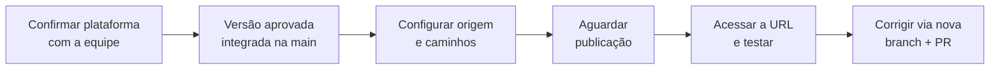

<div align="center">

# ⚡ GUIA DEFINITIVO DE GIT & GITHUB

### `PC BUILDER` · Simulador Interativo de Montagem de PC

**Documentação Oficial de Engenharia, Governança e Fluxo Colaborativo**


</div>

---

## 🧭 Sumário Navegável

| # | Seção | # | Seção |
|:-:|---|:-:|---|
| 1 | [Objetivo e Importância](#1-objetivo-e-importância-do-controle-de-versão) | 10 | [Revisão de PRs](#10-revisão-dos-pull-requests-code-review) |
| 2 | [Conceitos e Arquitetura](#2-git-github-e-repositório) | 11 | [Conflitos e Troubleshooting](#11-conflitos-e-problemas-comuns) |
| 3 | [Preparação e Interfaces](#3-preparação-e-interfaces-visuais) | 12 | [Boas Práticas e .gitignore](#12-boas-práticas-segurança-e-gitignore) |
| 4 | [Nomes de Branches](#4-padrão-de-nomes-das-branches) | 13 | [README e Materiais](#13-readme-e-materiais-de-apoio) |
| 5 | [Commits Semânticos](#5-padrão-das-mensagens-de-commit) | 14 | [Deploy e GitHub Pages](#14-deploy-e-github-pages) |
| 6 | [Catálogo de Comandos](#6-catálogo-completo-de-comandos-do-git) | 15 | [Checklist do PR](#15-checklist-antes-de-abrir-um-pull-request) |
| 7 | [Push, Pull e Fetch](#7-push-pull-e-fetch) | 16 | [Glossário](#16-glossário-técnico-expandido) |
| 8 | [Fluxo de 10 Etapas](#8-fluxo-de-trabalho-do-projeto-10-etapas) | 17 | [Resumo do Fluxo](#17-resumo-do-fluxo) |
| 9 | [Abrindo um PR](#9-como-abrir-um-pull-request) | | |

---

## 1. Objetivo e Importância do Controle de Versão

Este guia apresenta os conceitos fundamentais, a arquitetura de funcionamento, o catálogo de comandos e os procedimentos operacionais utilizados no projeto **PC Builder** (Simulador de Montagem de PC).

> [!IMPORTANT]
> 🎯 **Meta:** garantir que todos os integrantes trabalhem de forma organizada, acompanhem as alterações com precisão e colaborem em paralelo **sem prejudicar ou sobrescrever o trabalho dos outros grupos**.

### 💡 Por que o controle de versão é essencial no PC Builder?

Quando diversos grupos desenvolvem módulos diferentes de uma mesma aplicação web (HTML, CSS e JavaScript), o controle de versão resolve quatro problemas críticos:

| | Pilar | Descrição |
|:-:|---|---|
| 🔀 | **Isolamento de Escopo** | O Grupo 1 desenvolve a seleção de componentes enquanto o Grupo 2 constrói o cálculo de orçamento em tempo real, sem que o código em andamento de um trave o ambiente do outro. |
| 🔍 | **Rastreabilidade e Auditoria** | Registra quem alterou cada linha, quando e com qual propósito. |
| ⏪ | **Reversibilidade e Segurança** | Se uma alteração quebrar o layout ou a validação de compatibilidade de hardware, é possível comparar com a versão anterior e restaurar o funcionamento. |
| ✅ | **Controle de Qualidade** | Nenhum código entra na `main` sem testes locais e revisão técnica (Code Review). |

---

## 2. Git, GitHub e Repositório

### 2.1. Conceitos Fundamentais

| Conceito | O que é? | Finalidade prática no projeto |
|---|---|---|
| 🧰 **Git** | Sistema de controle de versão distribuído (DVCS) que roda localmente. | Registra alterações, mantém o histórico completo e compara versões sem depender de internet. |
| ☁️ **GitHub** | Plataforma em nuvem que hospeda repositórios Git. | Colaboração entre grupos: branches, Issues, Pull Requests, revisão de código e GitHub Pages. |
| 📦 **Repositório** | Local onde ficam os arquivos e todo o histórico (pasta oculta `.git`). | Divide-se em **Local** (no seu computador) e **Remoto** (no GitHub, apelido padrão `origin`). |
| 📸 **Commit** | Registro permanente (snapshot) de alterações, identificado por um hash SHA-1. | Documenta a evolução passo a passo, com mensagem curta e clara. Ex.: `docs: atualiza guia git github`. |
| 🌿 **Branch** | Linha de trabalho separada, criada a partir do código principal. | Permite desenvolver uma tarefa sem tocar na versão estável. A `main` é a versão principal. |
| 🔁 **Pull Request (PR)** | Solicitação formal para revisar e integrar (merge) uma branch em outra, normalmente a `main`. | Barreira de qualidade: revisão linha por linha, discussão e correções antes da integração. |

### 2.2. Arquitetura Interna: os 4 Ambientes do Arquivo



| Estágio | Estado do arquivo | Descrição |
|---|---|---|
| **Working Directory** | `Untracked` / `Modified` | Pasta visível onde você cria e edita. *Untracked* = arquivo novo que o Git ainda não monitora. *Modified* = arquivo conhecido que sofreu edições ainda não preparadas. |
| **Staging Area / Index** | `Staged` | Camada intermediária onde você seleciona (com `git add`) o que entra no próximo commit. |
| **Repositório Local** | `Committed` | Banco de dados na sua máquina onde `git commit` grava o pacote preparado. |
| **Repositório Remoto** | publicado | Servidor na nuvem para onde `git push` transmite seus commits, tornando-os acessíveis aos demais grupos. |

### 2.3. Recursos Extras do GitHub para a Equipe

| Recurso | Função |
|---|---|
| 🎫 **Issues** | Cartões para registrar tarefas, relatar bugs do simulador ou sugerir melhorias. Cada um recebe número único (ex.: `#15`). |
| 🏷️ **Labels** | Etiquetas coloridas para classificar atividades (`feat`, `bug`, `documentacao`, `grupo-1`, `revisao-pendente`). |
| 🎯 **Milestones** | Agrupam Issues e PRs para acompanhar o percentual de conclusão de uma entrega. |
| 📊 **GitHub Projects** | Quadro Kanban (A Fazer · Em Andamento · Em Revisão · Concluído) com a visão de todos os grupos. |
| 🔒 **Branch Protection Rules** | Impedem envios diretos na `main` e exigem revisão aprovada antes de liberar o *Merge*. |

---

## 3. Preparação e Interfaces Visuais

### ✅ Antes de qualquer tarefa

1. **Confirme o repositório:** você está no `pc-builder`?
2. **Verifique seu acesso:** sua conta tem permissão de escrita (*Write access*)?
3. **Consulte as regras:** leia o `README.md` e o arquivo normativo `PADROES_GIT.md`.
4. **Inspecione o estado local:** `git status` mostra a branch atual e alterações pendentes.
5. **Sincronize a base:** atualize a `main` antes de criar uma nova branch.

### 3.1. Interfaces Gráficas (GitHub Desktop e VS Code)

Você pode executar as operações mais comuns sem digitar todos os comandos no terminal.

<details>
<summary><b>🖥️ GitHub Desktop</b></summary>

| Elemento da tela | O que faz |
|---|---|
| **Current Repository** (topo esquerdo) | Confirma se você está no projeto `pc-builder`. |
| **Current Branch** (topo central) | Mostra a branch ativa e permite criar novas (*New Branch*). |
| **Fetch origin / Pull origin** (topo direito) | Busca e baixa as atualizações remotas do GitHub. |
| **Lista Changes** (esquerda) | Checkboxes selecionam arquivos (`git add`), o campo *Summary* recebe a mensagem (`git commit`) e **Push origin** envia (`git push`). |

</details>

<details>
<summary><b>🧩 VS Code (<code>Ctrl + Shift + G</code>)</b></summary>

| Ação | Equivalente |
|---|---|
| Clicar no ícone **+** ao lado de um arquivo modificado | `git add arquivo` |
| Clicar no nome do arquivo (comparação lado a lado, antes e depois) | `git diff` |

</details>

---

## 4. Padrão de Nomes das Branches

As branches devem seguir rigorosamente o padrão do `PADROES_GIT.md`:

```text
grupo-N/descricao-da-tarefa
```

### 4.1. Regras obrigatórias e motivos técnicos

| Regra | Motivo |
|---|---|
| 🔡 **Apenas letras minúsculas** | Servidores Linux (como o GitHub) diferenciam maiúsculas de minúsculas; o Windows não. Minúsculas evitam erros de referência entre computadores. |
| 🚫 **Sem espaços, acentos ou caracteres especiais** (`ç ~ ^ : ? *`) | Quebram URLs e têm significado reservado no terminal. |
| ➖ **Palavras separadas por hífen** | Padrão *kebab-case*, mais legível no terminal. |
| 👥 **Informar grupo e tarefa** | O prefixo `grupo-N/` identifica de imediato a equipe responsável. |
| 🔄 **Criar a partir da `main` atualizada** | Evita desenvolver sobre uma versão antiga do projeto. |

### 4.2. Exemplos comparativos

| Nome da branch | Status | Observação |
|---|:-:|---|
| `grupo-1/componentes` | ✅ Correto | Minúsculas, sem acentos, identifica grupo e tarefa. |
| `grupo-2/orcamento` | ✅ Correto | Sem cedilha (`c` no lugar de `ç`). |
| `grupo-3/correcao-compatibilidade` | ✅ Correto | Palavras separadas por hífen. |
| `Grupo-1/Componentes` | ❌ Incorreto | Utiliza letras maiúsculas. |
| `grupo-2/cálculo de orçamento` | ❌ Incorreto | Contém acento, cedilha e espaços. |

> [!WARNING]
> Os nomes acima são **exemplos** de tarefas. Antes de criar uma branch, confirme se ela corresponde exatamente à atividade definida para o seu grupo.

---

## 5. Padrão das Mensagens de Commit

Formato obrigatório:

```text
tipo: descricao curta
```

### 5.1. Diretrizes de escrita

- ✍️ Descrição clara, **em português** e **sem ponto final**.
- ▶️ Começa sempre com **verbo no presente do indicativo** (adiciona, corrige, atualiza, organiza, remove, simplifica).
- ⚛️ Representa uma alteração **específica e atômica**: commits pequenos, ligados a uma única tarefa.
- 🔎 Antes de registrar, confira quais arquivos foram modificados.

### 5.2. Tipos e finalidades

| Tipo | Finalidade | Exemplo |
|:-:|---|---|
| ✨ `feat` | Adicionar nova funcionalidade visível ou operacional ao simulador. | `feat: adiciona selecao de componentes` |
| 🐛 `fix` | Corrigir erro, falha de cálculo, link quebrado ou bug de comportamento. | `fix: corrige calculo do orcamento` |
| 📚 `docs` | Adicionar ou atualizar exclusivamente documentação (`.md`, manuais, comentários). | `docs: atualiza instrucoes do projeto` |
| 🧹 `chore` | Organizar arquivos, pastas, imagens ou tarefas estruturais de manutenção. | `chore: organiza pasta de imagens` |
| ♻️ `refactor` | Reorganizar e limpar o código interno sem alterar o comportamento final. | `refactor: simplifica validacao de pecas` |
| 🧪 `test` | Adicionar ou ajustar roteiros e scripts de testes. | `test: adiciona teste de compatibilidade` |

---

## 6. Catálogo Completo de Comandos do Git

> [!NOTE]
> Execute no terminal (Git Bash, PowerShell ou terminal integrado da IDE), sempre dentro da pasta local do projeto `pc-builder`.

### 6.1. Configuração inicial e clonagem

**Configurar a identidade do autor** (`git config`) — nome e e-mail que ficam gravados em cada commit:

```bash
git config --global user.name "Seu Nome Completo"
git config --global user.email "seu_email@exemplo.com"
```

> `--global` aplica a configuração a todos os repositórios do seu usuário. Use `git config --list` para conferir.

**Clonar o repositório** (`git clone`) — cópia local completa, com arquivos, branches e histórico:

```bash
git clone URL_DO_REPOSITORIO
```

**Conferir o endereço remoto** (`git remote -v`) — confirma a qual URL do GitHub a pasta está vinculada:

```bash
git remote -v
```

### 6.2. Diagnóstico, estado e comparação

**`git status`** — mostra a branch atual, se está sincronizada com o GitHub e quais arquivos foram modificados ou preparados.

```bash
git status        # visão completa
git status -s     # visão compacta
```

**`git diff`** — compara alterações linha por linha:

| Comando | O que mostra |
|---|---|
| `git diff` | Alterações no editor que ainda não receberam `git add`. |
| `git diff --staged` | Alterações já preparadas na Staging Area. |
| `git diff main` | Diferenças entre a sua branch atual e a `main`. |

### 6.3. Navegação e administração de branches

| Comando | Função |
|---|---|
| `git branch` | Lista as branches locais (`*` destaca a ativa). |
| `git branch -a` | Lista branches locais e remotas. |
| `git branch -m grupo-1/nome-correto` | Renomeia a branch atual. |
| `git branch -d grupo-1/tarefa-concluida` | Apaga uma branch local já integrada na `main`. |
| `git switch main` | Muda para a `main` (sem alterações locais conflitantes). |
| `git pull origin main` | Busca e integra as atualizações remotas da `main` (execute estando na `main`). |
| `git switch -c grupo-1/componentes` | Cria uma nova branch a partir da posição atual e já muda para ela. |

### 6.4. Preparação, registro e envio

| Comando | Função |
|---|---|
| `git add arquivo.ext` | Prepara um arquivo específico para o próximo commit. |
| `git add .` | Prepara todas as alterações da pasta atual *(só depois de conferir o `git status`)*. |
| `git add -p` | Modo interativo: escolhe trechos específicos dentro de um arquivo. |
| `git commit -m "docs: atualiza instrucoes do projeto"` | Grava as alterações preparadas no histórico local. |
| `git commit --amend -m "docs: atualiza guia git github"` | Corrige a mensagem do último commit local *(somente se ainda não fez push)*. |

**Enviar ao GitHub** (`git push`):

```bash
git push -u origin grupo-1/componentes
```

> A flag `-u` vincula a branch local à remota no primeiro envio; nos seguintes da mesma branch, basta `git push`.

### 6.5. Histórico e auditoria

| Comando | Função |
|---|---|
| `git log --oneline` | Resumo limpo: uma linha por commit (hash + mensagem). |
| `git log --oneline --graph --decorate --all` | Árvore visual de branches e merges. |
| `git log -n 5 --oneline` | Apenas os últimos 5 commits. |
| `git show HASH_DO_COMMIT` | Mostra exatamente quais linhas mudaram em um commit. |
| `git blame arquivo.js` | Mostra autor e commit responsável por cada linha do arquivo. |

### 6.6. Resgate, restauração e gaveta temporária

| Situação prática | Comando | Explicação |
|---|---|---|
| Tirar arquivo do `git add` (sem perder o código) | `git restore --staged arquivo.ext` | Remove da Staging Area, mantendo as edições no editor. |
| Descartar alterações ainda não commitadas | `git restore arquivo.ext` | Volta o arquivo ao estado do último commit. |
| Guardar trabalho inacabado temporariamente | `git stash -u` e depois `git stash pop` | Guarda numa "gaveta" para limpar a pasta e trocar de branch; depois devolve o código. |
| Reverter um commit que já subiu com bug | `git revert HASH_DO_COMMIT` | Cria um novo commit que desfaz o problemático, sem apagar o histórico. |

> [!CAUTION]
> `git restore arquivo.ext` **descarta edições permanentemente**. Confira com `git diff` antes de executar.

---

## 7. Push, Pull e Fetch

| Operação | Comando | O que faz |
|---|---|---|
| ⬆️ **Push** | `git push` | Envia os commits locais para o repositório remoto no GitHub. |
| ⬇️ **Pull** | `git pull` | Busca **e integra** as atualizações remotas na branch atual (`fetch` + `merge`). |
| 🔭 **Fetch** | `git fetch` | Verifica as atualizações remotas **sem integrá-las** aos arquivos da branch atual. |

> [!TIP]
> Não confunda: o **commit** registra a alteração apenas no histórico **local**; o **push** é que envia os commits ao GitHub.

---

## 8. Fluxo de Trabalho do Projeto (10 Etapas)



| # | Etapa | Descrição | Comando |
|:-:|---|---|---|
| 1 | **Atualizar a main** | Obter as alterações mais recentes do remoto. | `git switch main` · `git pull origin main` |
| 2 | **Criar uma branch** | Linha de trabalho para uma tarefa específica. | `git switch -c grupo-N/descricao-da-tarefa` |
| 3 | **Realizar alterações** | Modificar somente os arquivos necessários. | — |
| 4 | **Testar** | Verificar no navegador se funciona como esperado. | — |
| 5 | **Fazer commit** | Registrar com mensagem padronizada. | `git add` · `git commit -m "tipo: descricao"` |
| 6 | **Fazer push** | Enviar a branch ao GitHub. | `git push -u origin grupo-N/descricao-da-tarefa` |
| 7 | **Abrir um PR** | Solicitar revisão, com a `main` como destino. | *(no GitHub)* |
| 8 | **Revisar** | Verificar arquivos, commits, testes e descrição do PR. | *(no GitHub)* |
| 9 | **Corrigir, se necessário** | Ajustes na mesma branch e novo push. | `git push` |
| 10 | **Integrar** | Merge após as verificações e conforme as regras do repositório. | *(no GitHub)* |

> [!IMPORTANT]
> 🛑 **Regra de ouro:** não faça alterações diretamente na `main` quando a tarefa exigir o fluxo de branches e Pull Requests.

---

## 9. Como Abrir um Pull Request

### 9.1. Passo a passo

1. Envie sua branch ao GitHub com `push`.
2. Acesse a aba **Pull requests** do repositório.
3. Clique em **New pull request**.
4. Selecione `main` como **base** e sua branch como **compare**.
5. Informe um **título claro**.
6. Descreva **o que foi alterado e como foi testado**.
7. Confira os arquivos em **Files changed**.
8. Crie o PR e solicite revisão dos responsáveis (**Reviewers**).
9. Se pedirem correções, faça-as na mesma branch e envie novos commits. O PR é atualizado automaticamente.

### 9.2. Recursos úteis no PR

| Recurso | Descrição |
|---|---|
| 📝 **Draft Pull Request** | Abre o PR como rascunho enquanto o código está em construção, bloqueando o merge acidental. |
| 🔗 **Vinculação de Issues** | Escrever `Closes #N` na descrição fecha a Issue automaticamente após o merge na `main`. |
| 🔀 **Merge commit** | Mantém todos os commits e cria um commit de fusão. |
| 🧽 **Squash and merge** | Unifica todos os commits da branch em um só na `main`. |
| 📏 **Rebase and merge** | Reaplica os commits em linha reta. |

---

## 10. Revisão dos Pull Requests (Code Review)

Antes da integração, os revisores devem conferir:

- [ ] O título e a descrição explicam a tarefa.
- [ ] O nome da branch segue o padrão `grupo-N/descricao-da-tarefa`.
- [ ] As mensagens de commit estão padronizadas (`tipo: descricao curta`).
- [ ] Os arquivos modificados são os esperados.
- [ ] Os testes necessários foram realizados.
- [ ] Não existem senhas, tokens ou informações secretas.
- [ ] Eventuais conflitos foram resolvidos.
- [ ] As regras do repositório foram respeitadas.

> [!TIP]
> Havendo problemas, use **Request changes** na aba *Files changed* e solicite os ajustes antes de integrar. Você também pode comentar linhas específicas clicando no ícone **+** ao lado do número da linha, ou marcar arquivos já conferidos com a caixa **Viewed**.

---

## 11. Conflitos e Problemas Comuns

### 11.1. O que é um conflito?

Ocorre quando o Git não consegue combinar automaticamente alterações em partes incompatíveis dos arquivos, marcadas no código assim:

```diff
<<<<<<< HEAD
conteúdo da sua branch
=======
conteúdo da outra branch
>>>>>>> outra-branch
```

**Como resolver:**

1. Identifique os arquivos em conflito (`git status`).
2. Compare as alterações de cada bloco.
3. Converse com os integrantes envolvidos, se necessário.
4. Combine o conteúdo correto e **remova todos os marcadores** (`<<<<<<<`, `=======`, `>>>>>>>`).
5. Salve os arquivos e execute os testes necessários.
6. Confira as alterações antes de concluir a integração (`git add` e `git commit`).

### 11.2. Problemas comuns

<details>
<summary><b>🕳️ A alteração não aparece no GitHub</b></summary>

Confira, nesta ordem:

1. O arquivo foi salvo no editor (`Ctrl + S`)?
2. O Git reconheceu as alterações (`git status`)?
3. Foram feitos `git add` e `git commit`?
4. A branch foi enviada com `git push`?
5. Você selecionou a branch correta no site do GitHub?

</details>

<details>
<summary><b>🚫 Não consigo enviar alterações</b></summary>

- Verifique se está na conta correta e se possui acesso de escrita.
- Verifique se a branch foi criada corretamente.
- Se um colega de grupo subiu alterações na mesma branch antes de você, execute `git pull origin sua-branch` e tente o push novamente.
- Se necessário, procure o responsável pelo repositório.

</details>

<details>
<summary><b>📚 O Pull Request mostra arquivos demais</b></summary>

Confira se a branch foi criada a partir da base correta (`main` atualizada) e se contém apenas as alterações relacionadas à tarefa do grupo.

</details>

---

## 12. Boas Práticas, Segurança e `.gitignore`

| | Boa prática |
|:-:|---|
| 🌿 | Trabalhe em **uma branch específica para cada tarefa**. |
| 🔄 | **Atualize a base** (`main`) antes de iniciar uma nova branch. |
| ⚛️ | Faça **commits pequenos** e com mensagens claras. |
| 🔎 | Revise com `git status` e `git diff` antes de commit e push. |
| 💬 | **Converse com os outros grupos** antes de alterar arquivos compartilhados. |
| 🧪 | **Teste localmente** antes de solicitar a integração. |
| 📖 | Consulte o `PADROES_GIT.md` quando houver dúvidas. |

> [!CAUTION]
> 🔐 **Segurança:** nunca envie senhas, tokens, chaves privadas ou arquivos `.env` com informações secretas.

**Uso do `.gitignore`:** evite incluir arquivos temporários ou desnecessários, mantendo-os listados no `.gitignore` na raiz do projeto:

```gitignore
.DS_Store
Thumbs.db
.vscode/
node_modules/
.env
```

---

## 13. README e Materiais de Apoio

- 📘 O `README.md` é a **porta de entrada** do projeto: apresenta o objetivo do PC Builder, as instruções de execução, a organização dos arquivos e as orientações para contribuir.
- 🗂️ Apostilas e materiais de apoio ficam na pasta definida pela equipe, com nomes claros e organização que facilite a consulta.
- 📐 Respeite a **estrutura real do repositório** para evitar pastas duplicadas.

---

## 14. Deploy e GitHub Pages

**Deploy** é o processo de disponibilizar uma versão da aplicação para que outras pessoas a acessem pelo navegador.

O **GitHub Pages** pode ser uma opção para aplicações estáticas (HTML, CSS e JavaScript), desde que:

- a estrutura do projeto seja compatível (**caminhos relativos corretos** e atenção a maiúsculas/minúsculas nos nomes de arquivos);
- a equipe configure a publicação.



> [!NOTE]
> 📌 O fato de o código estar no GitHub **não** significa que o site já esteja publicado. O uso do GitHub Pages precisa ser confirmado e configurado pela equipe.

---

## 15. Checklist antes de Abrir um Pull Request

- [ ] Estou no repositório correto (`pc-builder`).
- [ ] Minha branch segue o padrão definido (`grupo-N/descricao-da-tarefa`).
- [ ] Não realizei alterações diretamente na `main`.
- [ ] Revisei os arquivos e as linhas modificadas (`git diff` e `git status`).
- [ ] Executei os testes necessários.
- [ ] As mensagens de commit estão claras e padronizadas (`tipo: descricao curta`).
- [ ] Não incluí senhas ou arquivos desnecessários.
- [ ] Enviei a branch correta ao GitHub (`git push`).
- [ ] O PR tem a `main` como destino.
- [ ] A descrição explica as alterações e como foram testadas.

---

## 16. Glossário Técnico Expandido

| Termo | Significado |
|---|---|
| **Git** | Sistema de controle de versões local. |
| **GitHub** | Plataforma online de hospedagem e colaboração. |
| **Repositório** | Projeto acompanhado pelo Git (local ou remoto). |
| **origin** | Apelido padrão do repositório remoto hospedado no GitHub. |
| **Clone** | Cópia local vinculada ao repositório remoto. |
| **Working Directory** | Pasta local onde os arquivos são editados no dia a dia. |
| **Staging Area** | Área de preparação onde os arquivos são selecionados (`git add`) antes do commit. |
| **Commit** | Registro de alterações selecionadas no histórico. |
| **Hash (SHA-1)** | Identificador único gerado para cada commit. |
| **Branch** | Linha de trabalho separada. |
| **main** | Branch principal do projeto. |
| **HEAD** | Ponteiro que indica a branch e o commit em que você está posicionado. |
| **Fetch** | Busca informações sobre atualizações remotas sem integrá-las. |
| **Pull** | Busca e integra atualizações remotas na branch atual. |
| **Push** | Envia commits ao repositório remoto. |
| **Pull Request (PR)** | Solicitação de revisão e integração de alterações. |
| **Code Review** | Revisão técnica das alterações de um PR antes da integração. |
| **Merge** | Integra alterações entre branches. |
| **Conflito** | Alterações incompatíveis que precisam ser conciliadas manualmente. |
| **Stash** | Gaveta temporária (`git stash`) que guarda edições locais sem precisar de commit. |
| **.gitignore** | Arquivo que define quais pastas e arquivos temporários o Git deve ignorar. |
| **Deploy** | Publicação da aplicação em um ambiente acessível. |

---

## 17. Resumo do Fluxo

```text
Atualizar a main ➔ Criar branch ➔ Alterar arquivos ➔ Testar ➔ Commit ➔ Push
        ➔ Pull Request ➔ Revisão ➔ Merge ➔ Deploy (quando aplicável)
```

<div align="center">

---

**⚡ PC Builder · Guia de Git & GitHub**

</div>
