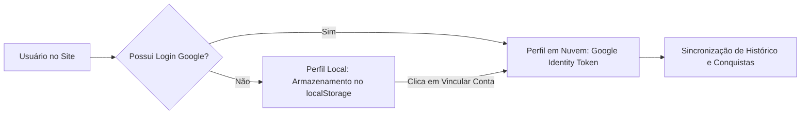
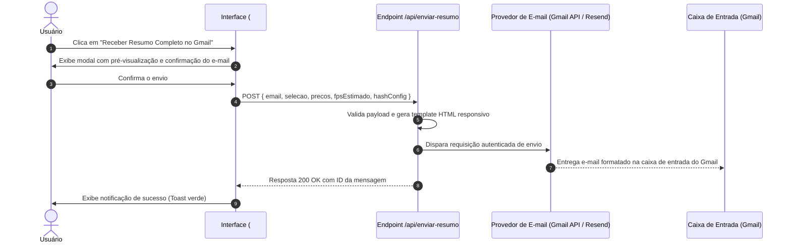

# PROPOSTAS FUTURAS DE EVOLUÇÃO — KONOHA HARDWARE
**Documento de Especificação Técnica de Novas Funcionalidades e Roadmap Estratégico**

---

## 1. Identificação do Documento

- **Projeto:** Konoha Hardware
- **Tipo de Documento:** Documento de Requisitos e Arquitetura para Evoluções Futuras (Roadmap v2.0)
- **Equipe Responsável:** Engenharia de Software (Equipe Konoha Hardware)
- **Status:** Proposta Técnica Detalhada para Implementação
- **Objetivo:** Especificar a arquitetura, regras de negócio, interface do usuário e fluxos de integração para três grandes pilares de inovação da plataforma:
  1. **Sistema de Recompensas e Gamificação (XP, Conquistas e Desbloqueáveis 3D)**
  2. **Aba de Perfil de Usuário (`#perfil`) com Garagem de Montagens e Histórico**
  3. **Envio da Montagem com Resumo Técnico Direto para o Gmail (com Deep Link e PDF)**

---

## 2. Pilar 1: Sistema de Recompensas e Gamificação

### 2.1. Motivação e Objetivos Pedagógicos
O público-alvo principal do Konoha Hardware é composto por estudantes e jovens de 15 a 24 anos. A introdução de dinâmicas de gamificação tem como propósito pedagógico:
- Estimular o aprendizado aprofundado dos princípios de Arquitetura da Computação (modelo de Von Neumann).
- Incentivar a exploração prática de diferentes cenários de montagem (custo-benefício, alto desempenho, eficiência energética).
- Recompensar a precisão e a observância rigorosa das regras físicas e elétricas de compatibilidade.

### 2.2. Economia de Gamificação: Níveis de Montador & Moedas Konoha (K-Coins)

```
┌────────────────────────────────────────────────────────────────────────┐
│                        HIERARQUIA DE MONTADOR                          │
├─────────────────┬───────────┬──────────────────────────────────────────┤
│ Nível / Patente │ XP Exigido│ Título Honorário                         │
├─────────────────┼───────────┼──────────────────────────────────────────┤
│ Nível 1 a 3     │ 0 - 500   │ Aprendiz de Hardware (Genin do Silício)  │
│ Nível 4 a 6     │ 501 - 1500│ Técnico de Montagem (Chunin das Placas)  │
│ Nível 7 a 9     │ 1501- 3500│ Engenheiro de Sistemas (Jonin do Over)   │
│ Nível 10 (Max)  │ 3500+     │ Mestre da Arquitetura (Kage do Hardware) │
└─────────────────┴───────────┴──────────────────────────────────────────┘
```

### 2.3. Matriz de Conquistas (Badges) e Gatilhos de Recompensa

| ID da Conquista | Título da Conquista | Gatilho / Requisito Técnico | Recompensa |
| :--- | :--- | :--- | :--- |
| `badge-first-build` | **Primeiro POST** | Concluir com sucesso uma montagem com as 8 peças 100% compatíveis. | +100 XP / 50 K-Coins |
| `badge-von-neumann` | **Mestre de Von Neumann** | Obter nota máxima (100% de acertos) em todos os 12 temas do Quiz Educativo. | +300 XP / 150 K-Coins / Badge Ouro |
| `badge-3d-snap` | **Mãos Limpas** | Montar um computador completo na bancada 3D utilizando a mecânica "Arrastar e Encaixar" sem errar nenhum slot. | +200 XP / 100 K-Coins / LED ARGB Arco-íris 3D |
| `badge-budget-king` | **Otimizador Econômico** | Montar um PC funcional com GPU dedicada para rodar jogos em 1080p custando menos de R$ 2.500,00. | +150 XP / 75 K-Coins |
| `badge-beast-mode` | **Poder Absoluto** | Montar uma máquina com processador topo de linha (ex: Ryzen 7 9800X3D ou Core Ultra 9) e RTX 4090 mantendo a refrigeração e a fonte perfeitamente balanceadas. | +250 XP / 125 K-Coins |
| `badge-speedrun-3d` | **Montagem Relâmpago** | Finalizar a montagem dos 8 componentes no visualizador 3D em menos de 90 segundos. | +350 XP / 200 K-Coins / Chassi Dourado 3D |

### 2.4. Desbloqueáveis Visuais para o Simulador 3D
As Moedas Konoha (K-Coins) acumuladas poderão ser trocadas em uma aba especial de customização do visualizador 3D:
1. **Cores e Efeitos de Iluminação ARGB:** Modos Onda, Respiração, Estroboscópico e paletas personalizáveis aplicadas em tempo real nos coolers e nas ventoinhas do gabinete gamer.
2. **Cabos Sleeved Customizados:** Opção de alternar entre cabos pretos padrão, cabos brancos texturizados ou cabos com malha trançada colorida na placa-mãe e na placa de vídeo.
3. **Pinturas de Gabinete:** Acabamentos preto fosco, branco nevado (*snow white*), cinza chumbo anodizado e edições temáticas especiais.

---

## 3. Pilar 2: Aba de Perfil de Usuário (`#perfil`)

### 3.1. Arquitetura e Roteamento
A aplicação ganhará uma nova rota integrada ao Hash Routing já existente: `#perfil`.  
O botão de acesso ao perfil será posicionado no cabeçalho global (`Header.tsx`), exibindo o avatar do usuário e seu nível atual.

### 3.2. Integração com Autenticação (Google OAuth 2.0 & Guest Fallback)
A autenticação continuará baseada no Google Identity Services (OAuth 2.0 com `NEXT_PUBLIC_GOOGLE_CLIENT_ID`), já integrado ao projeto:
- **Modo Visitante (Guest):** Usuários sem login podem acumular XP e salvar até 2 montagens temporárias no `localStorage` do navegador.
- **Modo Conectado (Google Account):** Sincronização automática em nuvem (via banco de dados em tempo real ou storage na nuvem), preservando os dados ao trocar de dispositivo ou limpar o cache.



### 3.3. Componentes da Interface da Tela de Perfil

1. **Card Principal de Identidade:**
   - Foto de perfil (recuperada do Google ou avatar personalizável).
   - Nome completo e e-mail vinculado.
   - Barra de progresso de Nível de Montador com medidor de XP para a próxima patente.
   - Saldo de Moedas Konoha (K-Coins).

2. **Garagem de Montagens ("Minhas Máquinas"):**
   - Lista de computadores montados e salvos pelo usuário (com título personalizado, data de criação e custo total).
   - Botões de ação rápida para cada máquina:
     * **Carregar no Montador:** Abre a configuração instantaneamente na aba `#montar`.
     * **Ver Relatório:** Exibe o resultado e o teste de FPS em `#resultado`.
     * **Enviar p/ Gmail:** Dispara o resumo técnico por e-mail com 1 clique.
     * **Excluir ou Duplicar Configuração.**

3. **Mural de Conquistas e Medalhas:**
   - Grade com todas as conquistas do sistema, divididas em *Desbloqueadas* (coloridas e interativas) e *Bloqueadas* (silhuetas com barra de progresso para conclusão).

4. **Painel de Estatísticas de Aprendizado:**
   - Histórico de desempenho no Quiz de Arquitetura da Computação:
     * Taxa geral de acertos.
     * Temas com melhor domínio (ex.: Memória Cache, Barramentos, Unidade Lógica e Aritmética).
     * Tempo médio gasto por questão.

---

## 4. Pilar 3: Envio da Montagem com Resumo Técnico Direto para o Gmail

### 4.1. Visão Geral da Funcionalidade
Na tela de resultado da montagem (`#resultado`), será disponibilizado um botão de destaque:  
**`[ ✉ Receber Resumo Completo no Gmail ]`**.

Caso o usuário esteja autenticado com sua conta Google, o campo de e-mail de destino será preenchido automaticamente, bastando um único clique para a confirmação de envio.



### 4.2. Estrutura Visual e Conteúdo do E-mail (Template Responsivo)
O e-mail será formatado com HTML transacional responsivo de alta qualidade, otimizado para o aplicativo mobile e desktop do Gmail:

1. **Cabeçalho Institucional:**
   - Logotipo oficial do Konoha Hardware.
   - Identificador único da montagem (ex.: `Montagem #KH-9842`).
   - Data e hora da geração do relatório.

2. **Resumo das 8 Peças Selecionadas:**
   - Tabela com imagem em miniatura de cada peça, categoria, nome comercial completo, especificações principais e preço individual em Reais (R$).
   - Valor Total do Computador e indicação do nível (Entrada, Intermediário, Avançado ou Entusiasta).

3. **Ficha Técnica de Compatibilidade & Energia:**
   - Plataforma e Soquete (ex.: AMD AM5 / LGA 1700).
   - Tipo de Memória (ex.: 32GB DDR5 6000MHz em Dual-Channel).
   - Consumo Elétrico Total Estimado (em Watts).
   - Fonte Mínima Recomendada com margem de segurança e certificação 80 Plus.
   - Status de Verificação: *Selo Verde de 100% de Compatibilidade Mecânica e Elétrica*.

4. **Tabela de Desempenho Estimado em Jogos:**
   - Projeção de FPS para os 6 jogos calibrados em 1080p e 1440p (CS2, Valorant, GTA V, Cyberpunk 2077, Fortnite, Warzone).

5. **Ações Interativas no E-mail (Deep Link e PDF):**
   - **Botão Principal (CTA):** *[ Abrir e Editar Esta Montagem no Konoha Hardware ]*  
     *(Link parametrizado com a chave da montagem que recarrega todas as peças diretamente no site com um clique).*
   - **Anexo Automático:** Arquivo `Resumo_Montagem_Konoha.pdf` anexado à mensagem contendo o espelho do relatório para impressão ou arquivamento.

### 4.3. Arquitetura de Implementação do Serviço de E-mail
Para manter a compatibilidade tanto com o servidor Next.js em produção quanto com a exportação estática (`out/`), a arquitetura suportará dois modelos:

- **Opção A (Recomendada para Next.js / Vercel):** Route Handler nativo em `app/api/enviar-resumo/route.ts` utilizando a biblioteca **Resend** ou **Nodemailer com transporte OAuth 2.0 do Google**, renderizando os e-mails com a biblioteca `@react-email/components`.
- **Opção B (Para Hospedagem 100% Estática / GitHub Pages):** Integração com uma Edge Function sem servidor (Cloudflare Worker ou Google Cloud Function) consumida via `fetch()` autenticado no front-end.

---

## 5. Especificação dos Novos Tipos e Schemas TypeScript

Para preservar a robustez e a tipagem estrita (`strict: true`) do projeto, os novos módulos serão modelados a partir das seguintes interfaces:

```typescript
// lib/konoha/recompensas.ts
export type CategoriaConquista = 'quiz' | 'montador' | '3d' | 'economia' | 'especial';

export interface Conquista {
  id: string;
  titulo: string;
  descricao: string;
  categoria: CategoriaConquista;
  icone: string;
  pontosXp: number;
  moedasKonoha: number;
  desbloqueadaEm?: string; // Data ISO
}

export interface Recompensa3D {
  id: string;
  nome: string;
  descricao: string;
  tipo: 'led-argb' | 'cabo-sleeved' | 'cor-chassi';
  precoMoedas: number;
  propriedadeThree: Record<string, unknown>;
  desbloqueada: boolean;
}

// lib/konoha/perfil.ts
export interface MontagemSalva {
  id: string;
  nomePersonalizado: string;
  criadaEm: string;
  atualizadaEm: string;
  pecasIds: Record<string, string>;
  valorTotal: number;
  consumoWatts: number;
}

export interface PerfilUsuario {
  id: string;
  email: string;
  nome: string;
  fotoUrl?: string;
  nivel: number;
  xpAtual: number;
  xpProximoNivel: number;
  moedas: number;
  conquistas: string[]; // IDs das conquistas desbloqueadas
  customizacoes3D: string[]; // IDs dos itens 3D adquiridos
  montagensSalvas: MontagemSalva[];
}

// lib/konoha/email.ts
export interface PayloadEnvioEmail {
  destinatarioEmail: string;
  nomeDestinatario?: string;
  idMontagem: string;
  pecas: Record<string, unknown>;
  valorTotalFormatado: string;
  consumoWatts: number;
  fonteRecomendadaWatts: number;
  fpsEstimado: Record<string, { fhd: number; qhd: number }>;
  deepLink: string;
}
```

---

## 6. Plano de Implementação e Distribuição por Integrante

A execução deste roadmap preservará os padrões de qualidade, branches e responsabilidades estabelecidas pelo time de 6 integrantes:

```
┌────────────────────────────────────────────────────────────────────────┐
│                   CRONOGRAMA DE ENTREGAS (SPRINTS)                     │
├─────────┬───────────────────────────┬──────────────────────────────────┤
│ Sprint  │ Foco Principal            │ Entregáveis                      │
├─────────┼───────────────────────────┼──────────────────────────────────┤
│ Sprint 1│ Backend & E-mail          │ • Endpoint de envio de e-mail    │
│         │ (Edwin & Leonardo)        │ • Template HTML com deep link    │
│         │                           │ • Branch: grupo-1/envio-gmail    │
├─────────┼───────────────────────────┼──────────────────────────────────┤
│ Sprint 2│ Perfil & Persistência     │ • Nova tela `#perfil`            │
│         │ (Breno & Giovane)         │ • Garagem de montagens salvas    │
│         │                           │ • Branch: grupo-1/aba-perfil     │
├─────────┼───────────────────────────┼──────────────────────────────────┤
│ Sprint 3│ Gamificação & Recompensas │ • Motor de cálculo de XP         │
│         │ (Eduardo & Gabriel)       │ • Loja de customizações 3D       │
│         │                           │ • Branch: grupo-1/recompensas    │
├─────────┼───────────────────────────┼──────────────────────────────────┤
│ Sprint 4│ Integração & Testes E2E   │ • Testes Playwright automatizados│
│         │ (Gabriel & Leonardo)      │ • Validação de envio e perfil    │
│         │                           │ • Branch: grupo-1/testes-qa      │
└─────────┴───────────────────────────┴──────────────────────────────────┘
```

### Atribuição Detalhada das Novas Tarefas
1. **Leonardo Fioramonte de Oliveira (Líder Técnico):** Arquitetura dos endpoints de API, modelagem das entidades de dados em nuvem e revisão dos contratos TypeScript.
2. **Breno Martinho Denis (Telas Iniciais & Visual):** Desenvolvimento visual da tela `#perfil`, design dos badges de conquista e responsividade da interface.
3. **Eduardo Francisco Bernardes da Silva (Catálogo):** Integração dos botões de salvamento na tela do montador e expansão dos itens visuais desbloqueáveis.
4. **Giovane Betez Romo (Resumo & Orçamento):** Adição do botão *"Receber no Gmail"* em `#resultado`, modal de confirmação e resumo de custos no e-mail.
5. **Edwin Bono Sanches (Lógica & Compatibilidade):** Desenvolvimento do microserviço de montagem do payload do e-mail, geração do deep link e regras de concessão de XP.
6. **Gabriel Rocha Martins (QA & 3D):** Aplicação dos desbloqueáveis de iluminação ARGB no Three.js e criação de novos testes E2E com Playwright para simular o fluxo de perfil e disparo de e-mail.

---

## 7. Critérios de Aceite e Garantia de Qualidade

Para que cada funcionalidade seja considerada pronta para produção, deverão ser atendidos os seguintes critérios:

- **Sistema de Recompensas:**
  - O XP e as moedas devem ser calculados instantaneamente ao disparar um gatilho.
  - As customizações visuais 3D desbloqueadas devem refletir imediatamente no gabinete sem queda de taxa de quadros (60 FPS estáveis).
- **Aba de Perfil:**
  - Carregar qualquer máquina salva da garagem deve preencher as 8 peças no montador sem perda de dados.
  - O histórico deve persistir de forma consistente após recarregar a página ou reabrir o navegador.
- **Envio no Gmail:**
  - O e-mail deve chegar na caixa de entrada em menos de 10 segundos após o clique.
  - O layout do e-mail deve ser renderizado perfeitamente em telas móveis e desktop, sem distorção das imagens das peças.
  - O link clicável no e-mail deve abrir a aplicação e carregar a mesma configuração com 100% de fidelidade.
- **Cobertura de Testes:**
  - Criação de novos testes automatizados no Playwright cobrindo os cenários de login, salvamento de montagem, desbloqueio de conquista e simulação de envio de e-mail.
  - Manutenção do status de **0 erros de compilação** no TypeScript (`tsc --noEmit`).

---
*Documento aprovado para planejamento e execução pela Equipe de Desenvolvimento do Konoha Hardware no Google Antigravity IDE.*
