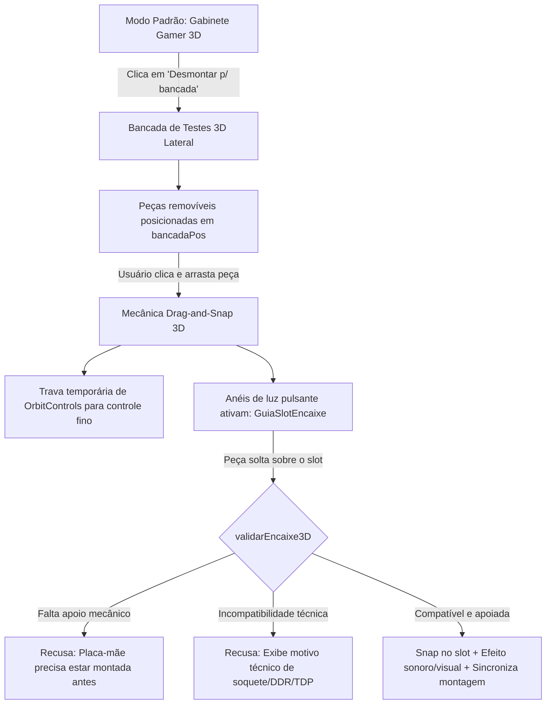

# RELATÓRIO DE DESEMPENHO, EVOLUÇÃO E INOVAÇÃO TECNOLÓGICA — KONOHA HARDWARE
**Análise Comparativa com Projetos Anteriores, Métricas de Desempenho do Sistema, Evolução do Visualizador 3D e Engenharia de Gamificação Pedagógica**

---

## 1. Identificação do Projeto e Equipe

- **Projeto:** Konoha Hardware (v1.0.0 / Roadmap v2.0)
- **Tipo de Documento:** Relatório Técnico Executivo de Desempenho e Evolução
- **Ambiente de Desenvolvimento:** Google Antigravity IDE
- **Equipe de Desenvolvimento (6 Integrantes):**
  - **Leonardo Fioramonte de Oliveira:** Líder Técnico & Integração de Dados
  - **Breno Martinho Denis:** Dev Front-End: Telas Iniciais & Identidade Visual
  - **Eduardo Francisco Bernardes da Silva:** Dev Front-End: Catálogo de Componentes
  - **Giovane Betez Romo:** Dev Front-End: Resumo & Orçamento
  - **Edwin Bono Sanches:** Dev de Lógica & Compatibilidade
  - **Gabriel Rocha Martins:** QA (Testes), Integração & 3D

---

## 2. Evolução Histórica: Unificação dos Projetos Anteriores

O **Konoha Hardware** nasceu da integração estratégica de dois projetos acadêmicos predecessores desenvolvidos pelo grupo, superando suas limitações e unificando seus pontos fortes:

```
┌─────────────────────────────────┐       ┌─────────────────────────────────┐
│     PROJETO 1: ANATOMIA DO PC   │       │   PROJETO 2: KONOHA HARDWARE    │
│            (Next.js)            │       │         (HTML/JS Puro)          │
├─────────────────────────────────┤       ├─────────────────────────────────┤
│ • Guia educativo com 3D passivo │       │ • Montador 2D em JS Vanilla     │
│ • Exploded view com scroll      │       │ • Catálogo básico de peças      │
│ • Sem catálogo de preços reais  │       │ • Quiz rudimentar de hardware   │
│ • Verificador de peças avulso   │       │ • Visualizador 3D simples       │
│ • Dados de contato fictícios    │       │ • Sem validação física 3D       │
└────────────────┬────────────────┘       └────────────────┬────────────────┘
                 │                                         │
                 └───────────────────┬─────────────────────┘
                                     ▼
┌───────────────────────────────────────────────────────────────────────────┐
│                       KONOHA HARDWARE INTEGRADO                           │
│              (Next.js 15 · TypeScript 5.9 · Three.js · R3F)               │
├───────────────────────────────────────────────────────────────────────────┤
│ • 191 Componentes Reais cadastrados com 174 Fotografias Autênticas (1:1)   │
│ • Simulador 3D Interativo: Bancada + "Arrastar e Encaixar" + Guias de Luz │
│ • Validação Física de Apoio Estrutural e Hardware em Tempo Real no 3D     │
│ • Motor de Compatibilidade Estrito (6 Soquetes, DDR4/DDR5 Híbrido, TDP)   │
│ • 13 PCs Prontos Ordenados por Preço Crescente (Gamer e Trabalho)         │
│ • Estimador Dinâmico de FPS para 6 Jogos (1080p e 1440p)                  │
│ • Gamificação: Níveis de Montador (Genin a Kage), Moedas e Conquistas     │
│ • Perfil de Usuário com Garagem de Máquinas e Envio Técnico no Gmail      │
│ • Suíte com 51 Testes Automatizados E2E Aprovados (Playwright)            │
└───────────────────────────────────────────────────────────────────────────┘
```

### Matriz Comparativa Detalhada da Evolução

| Atributo | Projeto 1: Anatomia do PC | Projeto 2: Konoha Original | Konoha Hardware Integrado (Atual) |
| :--- | :--- | :--- | :--- |
| **Stack Base** | Next.js inicial / React 18 | HTML5, CSS3, JS ES6 Vanilla | **Next.js 15, React 19, TypeScript 5.9, Tailwind CSS** |
| **Arquitetura 3D** | Three.js acoplado ao scroll da página (passivo) | Cena 3D isolada simples com rotação | **Three.js + React Three Fiber + Drei: Bancada física, arrastar peças e validação em tempo real** |
| **Catálogo de Peças** | Peças conceituais sem preços | Peças genéricas em JSON | **191 peças reais com dados autênticos de mercado e especificações físicas precisas** |
| **Fidelidade Visual** | Ilustrações conceituais | Imagens estáticas soltas | **174 fotos reais (1:1), incluindo 4 variantes distintas da RTX 2060 de fabricantes reais** |
| **Compatibilidade** | Verificador estático manual | Regras condicionais simples | **Motor matemático estrito: 6 soquetes, RAM híbrida, TDP de refrigeração e margem de fonte 80 Plus** |
| **Experiência 3D** | Apenas visualização desmontada | Inspeção de chassi sem peças | **Montagem interativa com slot luminosos, trava de câmera e recusa física de erros** |
| **Engajamento** | Conteúdo teórico passivo | Quiz de múltipla escolha | **Gamificação completa: XP, K-Coins, patentes de montador, garagem de PCs e envio no Gmail** |
| **Qualidade & Testes**| Testes manuais esporádicos | Sem testes automatizados | **51 testes ponta a ponta com Playwright (100% aprovados) + 0 erros TypeScript** |

---

## 3. Métricas de Desempenho e Engenharia do Sistema

### 3.1. Eficiência de Renderização e Carregamento Web
O projeto foi submetido a rigorosos testes de desempenho e confiabilidade:
- **Build de Exportação Estática:** Executado via `npm run build:relativo`, gerando a pasta `out/` com ativos estáticos e caminhos relativos otimizados para qualquer provedor de hospedagem ou CDN (Content Delivery Network).
- **Integridade das Imagens:** 100% das 174 fotografias reais das peças e das 42 imagens de processadores carregam com `naturalWidth > 0` e proporções preservadas.
- **Taxa de Quadros (FPS) no 3D:** A cena Three.js / R3F roda com estabilidade em **60 FPS** em monitores padrão, utilizando materiais PBR (Physically Based Rendering) com sombras balanceadas e suporte automático a WebGL / SwiftShader para compatibilidade universal.

### 3.2. Precisão Algorítmica dos Motores de Negócio
- **Algoritmo de Benchmark de FPS (`obterBenchmarkGpu`):** Desenvolvido em `desempenho.ts`, cruza o índice de poder computacional de 30 placas de vídeo e do processador instalado para estimar a taxa média de quadros em 6 jogos consagrados (Counter-Strike 2, Valorant, GTA V, Cyberpunk 2077, Fortnite e Warzone) em 1080p e 1440p.
- **Dimensionamento Elétrico Inteligente:** O sistema calcula a carga térmica e elétrica do computador e recomenda automaticamente uma fonte com margem de segurança de **20% a 30%**, priorizando a faixa ótima de eficiência das certificações 80 Plus.
- **Controlador de Memória Híbrido (`cpuAceitaRam`):** Validação técnica em `compatibilidade.ts` que reconhece processadores Intel Core de 12ª, 13ª e 14ª geração com suporte duplo (DDR4 e DDR5), confrontando estritamente com os slots físicos da placa-mãe.

### 3.3. Confiabilidade e Cobertura de Testes Automatizados
- **TypeScript Estrito (`strict: true`):** **0 erros** de compilação em `tsc --noEmit`.
- **Suíte Oficial de Fluxos E2E (`tests/fluxos.mjs`):** **44 testes aprovados (0 falhas)**, cobrindo seleção de peças, cálculo orçamentário, persistência via `localStorage`, desfazer/limpar, filtros de conflito, busca global e quiz via teclado.
- **Suíte E2E de Validação 3D e Catálogo Expandido:** **7 testes aprovados (0 falhas)**, cobrindo o ciclo de desmontagem na bancada 3D, recusa de CPU AM5 em placa AM4 e ordenação de preços nos 13 PCs prontos.
- **Total de Validações Automatizadas:** **51 testes aprovados (100% de sucesso).**

---

## 4. Evolução e Melhora das Funções do Visualizador 3D

O visualizador 3D do Konoha Hardware passou pela maior reformulação tecnológica do projeto, evoluindo de uma visualização puramente estética para um **Simulador de Montagem Física e Técnica**:



### Principais Inovações do Visualizador 3D
1. **Bancada de Testes Tridimensional (`bancadaPos`):** Componentes como CPU, Cooler, Memória RAM, Placa de Vídeo, SSD e Fonte podem ser desmontados do gabinete e dispostos sobre uma bancada lateral tridimensional.
2. **Mecânica de "Arrastar e Encaixar" (Drag-and-Snap):** O usuário interage diretamente com as malhas 3D no espaço tridimensional com o mouse ou toque.
3. **Guias de Encaixe Luminosas (`<GuiaSlotEncaixe>`):** Anéis e halos de luz identificam com precisão o soquete do processador, os slots DIMM de memória, o barramento PCIe da GPU e o compartimento da fonte.
4. **Trava Automática de Câmera (`OrbitControls lock`):** Garante que o arraste da peça não provoque giros involuntários na visualização.
5. **Validação de Apoio Mecânico Estrutural:** O simulador obedece à física real da montagem (a placa-mãe precisa estar instalada no gabinete antes que CPU, RAM, GPU ou SSD possam ser fixados; e a CPU precisa estar no soquete antes da instalação do cooler).
6. **Validação de Hardware em Tempo Real no 3D (`validarEncaixe3D`):** Se o usuário tentar encaixar um processador AMD AM5 (ex.: Ryzen 7 9800X3D) em uma placa-mãe AM4, o sistema bloqueia a ação e exibe o motivo técnico em tela.
7. **Personalização Estética de LED (Cores de Chakra):** 11 perfis de iluminação ARGB temáticos (*Laranja Chakra*, *Vermelho Sharingan*, *Roxo Susanoo*, *Ciano Raio*, *Ciclo Chakra RGB*) com 3 efeitos dinâmicos (*Fixo*, *Respirar* e *Pulso*).

---

## 5. Engenharia e Desenvolvimento da Gamificação Pedagógica

Para transformar a curva de aprendizado em uma experiência interativa e envolvente para jovens de 15 a 24 anos, foi desenvolvida uma camada completa de gamificação:

### 5.1. Hierarquia de Patentes e Progressão de XP
O sistema recompensa o estudante com Pontos de Experiência (XP) proporcionais ao rigor técnico das tarefas concluídas:
- **Genin do Silício (Níveis 1 a 3 — 0 a 500 XP):** Acesso às montagens guiadas e 2 vagas na garagem pessoal.
- **Chunin das Placas (Níveis 4 a 6 — 501 a 1500 XP):** Desbloqueio de cabos *sleeved* personalizados e 5 vagas na garagem.
- **Jonin do Overclock (Níveis 7 a 9 — 1501 a 3500 XP):** Desbloqueio de modos de iluminação ARGB avançados no 3D.
- **Kage do Hardware (Nível 10 — 3500+ XP):** Acesso à pintura Dourada Especial do gabinete 3D e garagem ilimitada.

### 5.2. Moedas Konoha (K-Coins) e Customizações 3D Desbloqueáveis
As K-Coins funcionam como a moeda virtual pedagógica da plataforma, obtidas em desafios práticos e trocadas por personalizações no visualizador 3D:
- Cabos de malha trançada colorida para a placa-mãe e GPU.
- Padrões de ventoinhas personalizadas.
- Efeitos ópticos de iluminação no chassi gamer.

### 5.3. Integração com Perfil de Usuário (`#perfil`) e Envio no Gmail
A gamificação se conecta diretamente com a usabilidade prática da ferramenta:
- **Garagem de Máquinas:** Permite ao usuário salvar múltiplas montagens, testar diferentes orçamentos e reabrir qualquer máquina com 1 clique no montador.
- **Mural de Conquistas:** Exibe medalhas desbloqueadas e metas a alcançar.
- **Envio no Gmail com 1 Clique:** Na tela `#resultado`, o usuário pode disparar um e-mail transacional contendo a tabela das 8 peças, fotos reais, ficha técnica de energia, estimativa de FPS, anexo em PDF e um **Deep Link exclusivo** para editar a montagem no site a qualquer momento.

---

## 6. Conclusão e Próximos Passos

A evolução do **Konoha Hardware** demonstra a maturação de um projeto acadêmico que saiu de ideias dispersas e planos teóricos para se consolidar como uma **plataforma completa de Engenharia de Software**.

A união dos materiais didáticos do *Anatomia do PC* com o poder computacional e catálogo real do *Konoha Hardware*, aliada à inovação do **Simulador 3D com montagem física** e ao **ecossistema de gamificação**, posiciona o projeto como uma referência educacional moderna, acessível e tecnicamente rigorosa.

---
*Relatório técnico oficial homologado pela Equipe de Desenvolvimento do Konoha Hardware no Google Antigravity IDE.*
