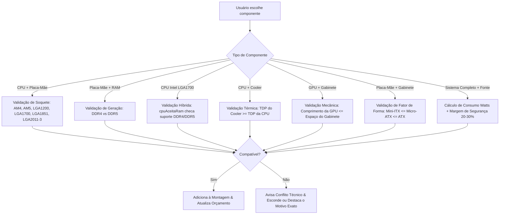

# DOCUMENTAÇÃO TÉCNICA E DE ARQUITETURA — KONOHA HARDWARE
**Plataforma Educacional de Arquitetura da Computação e Simulador de Montagem de PC**

---

## 1. Identificação do Projeto e Equipe

- **Nome do Projeto:** Konoha Hardware
- **Natureza:** Projeto Acadêmico / Plataforma Web Educacional de Engenharia de Software
- **Público-Alvo:** Estudantes de tecnologia, entusiastas e jovens de 15 a 24 anos interessados em hardware e montagem de computadores
- **Ambiente de Desenvolvimento Padronizado (IDE):** Google Antigravity IDE (com agentes autônomos de desenvolvimento e análise de código)
- **Controle de Versão:** Git & GitHub (Fluxo de trabalho com branches por integrante e Conventional Commits)

### Equipe de Desenvolvimento e Atribuições
| Integrante | Função no Projeto | Responsabilidades Principais |
| :--- | :--- | :--- |
| **Leonardo Fioramonte de Oliveira** | Líder Técnico & Integração de Dados | Arquitetura Next.js/TypeScript, integração do catálogo com 191 peças reais, padronização no Google Antigravity IDE e pipeline de build estático. |
| **Breno Martinho Denis** | Dev Front-End: Telas Iniciais & Identidade Visual | Design System (Tailwind CSS, tipografia Unbounded/Manrope), telas de navegação, telas Início, PCs Prontos e acessibilidade visual. |
| **Eduardo Francisco Bernardes da Silva** | Dev Front-End: Catálogo de Componentes | Interface do Montador por etapas (`#montar`), cards de componentes, filtros inteligentes, badges de especificações e galeria de fotos reais. |
| **Giovane Betez Romo** | Dev Front-End: Resumo & Orçamento | Tela de resultado (`#resultado`), estimativa de consumo energético, distribuição gráfica de custos e cálculo em tempo real. |
| **Edwin Bono Sanches** | Dev de Lógica & Compatibilidade | Motor de compatibilidade (`compatibilidade.ts`), validação física de soquetes, suporte híbrido DDR4/DDR5, cálculo de TDP e calibração de FPS. |
| **Gabriel Rocha Martins** | QA (Testes), Integração & 3D | Suíte de testes ponta a ponta com Playwright (`tests/fluxos.mjs`), integração das cenas 3D no Three.js e controle de qualidade contínua. |

---

## 2. Visão Geral e Evolução do Projeto

### O Ponto de Partida vs. O Resultado Final
O documento original de planejamento previa um simulador simplificado em JavaScript Vanilla (ES6 modular), HTML5 e CSS3 básico, estruturado em arquivos dispersos, com apenas 7 categorias abstratas e peças genéricas.

Durante o ciclo de desenvolvimento, o projeto evoluiu para o **Konoha Hardware**: uma plataforma completa e robusta que unificou o conceito pedagógico do *Anatomia do PC* (exploração 3D interativa e anatomia de hardware) com a precisão técnica e comercial de um montador profissional com peças e fotografias reais do mercado brasileiro.

```
┌────────────────────────────────────────────────────────────────────────┐
│                          KONOHA HARDWARE                               │
├──────────────────────────────────────────┬─────────────────────────────┤
│             NÚCLEO EDUCATIVO             │     SIMULADOR & MONTADOR    │
│  • Modelo 3D Exploded View interativo   │  • 191 Peças Reais Cadastradas │
│  • Visualizador de conexões e barramento │  • 174 Fotos Reais Autênticas │
│  • Quiz interativo (12 temas)           │  • Validação Estrita em Tempo │
│  • Glossário de termos e FAQ técnico     │    Real (Soquete, DDR, TDP)   │
│  • Artigos e Guias de Arquitetura        │  • 13 PCs Prontos Ordenados │
├──────────────────────────────────────────┴─────────────────────────────┤
│         NOVIDADE: BANCADA 3D INTERATIVA ("ARRASTAR E ENCAIXAR")         │
│   Desmonte para a bancada, arraste peças físicas até os slots 3D,      │
│   validação de ordem de montagem física e compatibilidade em tempo real│
└────────────────────────────────────────────────────────────────────────┘
```

---

## 3. Stack Tecnológica e Arquitetura de Software

### 3.1. Tecnologias Utilizadas
- **Framework Principal:** [Next.js 15](https://nextjs.org/) (App Router, renderização otimizada, exportação estática `out/` com suporte a caminhos relativos).
- **Linguagem:** [TypeScript 5.9](https://www.typescriptlang.org/) (modo estrito habilitado, tipagem integral de hardware, regras e eventos).
- **Biblioteca de UI:** [React 19](https://react.dev/) (Hooks reativos, componentes client-side isolados e gerenciamento de estado persistente).
- **Renderização e Física 3D:** 
  - [Three.js 0.186](https://threejs.org/)
  - [@react-three/fiber 9.8](https://docs.pmnd.rs/react-three-fiber) (Canvas reativo no ecossistema React)
  - [@react-three/drei 10.7](https://github.com/pmndrs/drei) (OrbitControls, luzes, sombras, overlays)
  - Postprocessing (efeitos de luz e destaque em tempo real)
- **Estilização e Design System:**
  - [Tailwind CSS 3.4](https://tailwindcss.com/)
  - Fontes Variáveis do Fontsource: *Unbounded* (títulos futuristas), *Manrope* (leitura fluida) e *JetBrains Mono* (dados técnicos).
- **Animações e Transições:** [Framer Motion 14](https://www.framer.com/motion/) e [GSAP 3.15](https://greensock.com/gsap/).
- **Qualidade e Testes Automatizados:** [Playwright 1.63](https://playwright.dev/) para testes E2E reais no navegador Chromium.
- **Autenticação:** Google Identity Services OAuth 2.0 (configurável via variável de ambiente `NEXT_PUBLIC_GOOGLE_CLIENT_ID`).

### 3.2. Estrutura Real de Diretórios do Projeto
```
konoha-hardware/
├── app/                              # Configuração Next.js App Router
│   ├── layout.tsx                    # Layout raiz, fontes variáveis e metadados
│   ├── page.tsx                      # Orquestrador de telas por Hash Routing (#)
│   └── globals.css                   # Variáveis de tema CSS, resets e utilitários
├── components/
│   ├── montador/                     # Módulos do Montador de PC
│   │   ├── Montador.tsx              # Fluxo de 8 etapas, busca global e filtros
│   │   ├── ConferirPecas.tsx         # Verificador avulso de peças externas
│   │   └── Resultado.tsx             # Relatório técnico, cálculo de FPS e orçamento
│   ├── telas/                        # Telas da aplicação (uma por arquivo)
│   │   ├── Inicio.tsx                # Landing page principal
│   │   ├── Aprender.tsx              # Guia 3D educativo (Anatomia do PC)
│   │   ├── Montar.tsx                # Wrapper da aba Montar
│   │   ├── PcGamer.tsx               # Vitrine dos 7 PCs Gamer (menor ao maior preço)
│   │   ├── PcTrabalho.tsx            # Vitrine dos 6 PCs Trabalho (menor ao maior preço)
│   │   ├── Prontos.tsx               # Comparador "Pronto vs Montado"
│   │   ├── Quiz.tsx                  # Quiz interativo de Arquitetura de Computadores
│   │   ├── Duvidas.tsx               # Glossário de termos e FAQ
│   │   └── Equipe.tsx                # Ficha técnica dos 6 integrantes
│   ├── three/                        # Motores e componentes 3D
│   │   ├── GamerChassis3D.tsx        # Cena 3D com montagem interativa e bancada
│   │   ├── gamer/Modelo.tsx          # Malhas 3D das peças, slots luminosos e drag-and-drop
│   │   ├── gamer/dados.ts            # Posições de slots, bancada e regras físicas 3D
│   │   ├── Chassis3D.tsx             # Gabinete 3D da tela educativa
│   │   └── ExplodedChassis.tsx       # Efeito de desmontagem 3D sincronizado com o scroll
│   └── ui/                           # Componentes genéricos de UI acessível
│       ├── Confirmacao.tsx           # Modal de confirmação seguro com foco
│       ├── Toast.tsx                 # Notificações não invasivas com ação Desfazer
│       └── Header.tsx / Footer.tsx   # Cabeçalho global com busca e rodapé
├── lib/
│   ├── konoha/                       # Núcleo de regras de negócio puras
│   │   ├── pecas.ts                  # Catálogo de 191 componentes reais
│   │   ├── compatibilidade.ts        # Motor de validação de compatibilidade
│   │   ├── desempenho.ts             # Estimador dinâmico de FPS e produtividade
│   │   ├── pcs-prontos.ts            # Configurações pré-montadas e dados da equipe
│   │   ├── quiz.ts                   # Banco de 12 temas e perguntas pedagógicas
│   │   └── tipos.ts                  # Interfaces TypeScript rígidas de hardware
│   ├── montagem.ts                   # Store da seleção do usuário (localStorage + histórico)
│   └── rotas.ts                      # Gerenciador de navegação via Hash SPA
├── public/
│   └── img/pecas/reais/              # 174 fotografias reais das peças físicas
├── scripts/                          # Scripts de automação e caminhos relativos
├── tests/
│   └── fluxos.mjs                    # Suíte oficial de 44 testes E2E com Playwright
├── DOCUMENTACAO.md                   # Este documento técnico oficial
├── package.json                      # Dependências e scripts de execução
├── tailwind.config.ts                # Configuração do Tailwind CSS
└── tsconfig.json                     # Configuração estrita do TypeScript
```

---

## 4. O Catálogo de Peças Reais e Correspondência de Imagens

Diferente do plano inicial de 7 categorias genéricas sem marcas reais, o catálogo foi expandido para **8 categorias essenciais**, incorporando **191 componentes reais** com **174 fotografias autênticas** de alta fidelidade visual:

### 4.1. Distribuição dos Componentes Cadastrados
1. **Processadores (`cpu`) — 42 modelos:**
   - Intel LGA 1200 (10ª e 11ª geração Core i3/i5/i7/i9)
   - Intel LGA 1700 (12ª, 13ª e 14ª geração Core i3/i5/i7/i9 com suporte híbrido DDR4/DDR5)
   - Intel LGA 1851 (Nova geração Core Ultra 5/7/9 200S)
   - Intel Xeon LGA 2011-3 (Xeon E5 v3/v4 para plataformas de alta densidade/X99)
   - AMD AM4 (Linhas Ryzen 3000, 4000 e 5000, incluindo 5800X3D)
   - AMD AM5 (Linhas Ryzen 7000, 8000G e 9000, incluindo 7800X3D e 9800X3D)
2. **Placas-Mãe (`placa-mae`) — 37 modelos:**
   - Chipsets Intel: H410, B460, H510, B560, H610, B660, B760, Z690, Z790, Z890
   - Chipsets AMD: A320, B450, B550, X570, A620, B650, X670E, X870
   - Plataforma X99 / LGA 2011-3 (Machinist, Huananzhi)
   - Formatos: Mini-ITX, Micro-ATX e ATX
3. **Memórias RAM (`ram`) — 14 modelos/kits:**
   - Módulos DDR4 (2666MHz a 3600MHz, de 8GB a 64GB kits)
   - Módulos DDR5 (4800MHz a 6400MHz, de 16GB a 64GB kits)
   - Módulos com e sem iluminação RGB, além de memórias ECC Registradas para Xeon
4. **Placas de Vídeo (`gpu`) — 30 modelos:**
   - Linha NVIDIA GeForce: GTX 1650, RTX 2060 (múltiplas variantes de fabricantes reais), RTX 3050, RTX 3060, RTX 4060, RTX 4070, RTX 4080 Super e RTX 4090
   - Linha AMD Radeon: RX 580 8GB, RX 6600, RX 7600, RX 7700 XT, RX 7800 XT, RX 7900 XTX
5. **Armazenamento (`armazenamento`) — 16 modelos:**
   - SSDs NVMe M.2 PCIe 3.0, 4.0 e 5.0 (de 500GB a 2TB)
   - SSDs SATA III de 2.5 polegadas (240GB a 1TB)
   - HDDs mecânicos de 3.5 polegadas para armazenamento em massa
6. **Fontes de Alimentação (`fonte`) — 34 modelos:**
   - Potências de 400W a 1600W
   - Certificações 80 Plus: White, Bronze, Gold e Platinum
   - Modelos Standard, Semi-Modulares e Full-Modulares
7. **Gabinetes (`gabinete`) — 3 modelos de referência:**
   - Gabinetes compactos Micro-ATX (ex.: HX300M Glass)
   - Gabinetes Mid Tower e Aquário com fluxo de ar otimizado
8. **Sistemas de Refrigeração (`cooler`) — 15 modelos:**
   - Air Coolers tipo torre (ex.: Cooler Master Hyper 212, DeepCool AK400/AK620)
   - Water Coolers AIO de 240mm e 360mm (ex.: Corsair iCUE, Lian Li Galahad)

### 4.2. Tratamento Especial de Fidelidade Visual: NVIDIA GeForce RTX 2060
Para atender rigorosamente à regra de não homogeneizar produtos com nomes similares, foram associadas 4 fotografias reais distintas às 4 variantes físicas do modelo RTX 2060:
- **ASUS Dual GeForce RTX 2060 EVO:** Carenagem preta espessa com 2 fans axial-tech de pás unidas e placa traseira de alumínio.
- **MSI GeForce RTX 2060 Gaming Z:** Carenagem com detalhes cinza metálico, ventoinhas TORX 3.0 e sistema de iluminação Mystic Light.
- **Gigabyte GeForce RTX 2060 WindForce OC:** Carenagem geométrica clássica com ventoinhas de rotação alternada de 90mm.
- **Zotac Gaming GeForce RTX 2060 Twin Fan:** Formato ultracompacto de dois slots com lâminas curvas otimizadas para gabinetes menores.

---

## 5. Regras Avançadas de Compatibilidade de Hardware

O motor de compatibilidade (`lib/konoha/compatibilidade.ts`) implementa um conjunto robusto de validações técnicas que atuam em tempo real durante a seleção de cada componente:



### Principais Regras Implementadas
1. **Compatibilidade de Soquete:** Garante correspondência estrita entre o soquete da CPU e o soquete da placa-mãe.
2. **Suporte Híbrido DDR4/DDR5:** Processadores Intel de 12ª, 13ª e 14ª geração possuem controladores de memória compatíveis com ambas as tecnologias. A função `cpuAceitaRam` autoriza o uso de qualquer memória suportada pela CPU, delegando à placa-mãe a decisão final do tipo físico de slot.
3. **Equilíbrio Térmico (TDP):** Avalia se a capacidade de dissipação de calor do Cooler (em Watts) atende ao TDP máximo do processador em carga.
4. **Dimensionamento Elétrico Inteligente:** O sistema soma o consumo estimado da CPU, GPU e periféricos em carga total e compara com a potência real fornecida pela Fonte de Alimentação, alertando caso a fonte não forneça a margem de segurança necessária.
5. **Conferência Física de Espaço:** Impede a escolha de placas-mãe de padrão ATX em gabinetes construídos exclusivamente para Micro-ATX ou Mini-ITX, além de confrontar o comprimento da placa de vídeo (em mm) com o espaço interno do chassi.

---

## 6. Funcionalidades Inovadoras Implementadas

### 6.1. Montagem Manual 3D ("Arrastar e Encaixar" / Bancada 3D)
Construída dentro do visualizador 3D existente (`GamerChassis3D.tsx` e `Modelo.tsx`), essa funcionalidade permite uma experiência de montagem prática sem precedentes:
- **Modo Bancada de Trabalho:** Ao clicar no botão *"Desmontar p/ bancada"*, os componentes removíveis saem do interior do gabinete e se posicionam sobre a bancada lateral 3D.
- **Interação Drag-and-Snap com Ponteiro:** O usuário pode clicar sobre a peça desejada na bancada e arrastá-la com o mouse/touch até o interior do gabinete.
- **Guias Luminosas de Encaixe (`<GuiaSlotEncaixe>`):** Conforme a peça se aproxima do slot correto (ex.: CPU no soquete da placa-mãe, RAM nos slots DIMM, GPU no barramento PCIe), anéis visuais luminosos são exibidos destacando a área de engate.
- **Bloqueio de Câmera:** Durante a operação de arraste, os controles de órbita (`OrbitControls`) são temporariamente travados, garantindo precisão milimétrica sem desvios de perspectiva.
- **Validação de Ordem Física de Instalação:** O simulador impede encaixar peças sem a estrutura de apoio correspondente (exemplo: o processador só pode ser montado se a placa-mãe já estiver parafusada no gabinete).
- **Validação de Hardware em 3D:** Através da função `validarEncaixe3D`, o usuário pode testar peças incompatíveis diretamente no 3D (como tentar encaixar um processador AMD AM5 em uma placa-mãe AM4) e receber o motivo técnico de recusa imediatamente.

### 6.2. Vitrines de PCs Prontos Ordenadas por Preço
As telas de computadores pré-configurados foram reformuladas para apresentar opções balanceadas, prontas para uso ou personalização, organizadas do menor para o maior preço:
- **Aba Gamer (`#gamer`) — 7 Máquinas:**
  1. *Econômico X99 & RX 580 8GB:* R$ 2.419,30
  2. *Entrada Intel Core i3 & RTX 3050:* R$ 3.699,30
  3. *Entrada AMD Ryzen 5 & RX 6600:* R$ 3.999,30
  4. *Intermediário Ryzen 5 & RTX 4060:* R$ 5.409,30
  5. *Avançado 1440p Ryzen 7 & RTX 4070 Super:* R$ 6.679,30
  6. *Entusiasta 4K Core i7 & RTX 4080 Super:* R$ 11.519,30
  7. *Extremo Competitivo Ryzen 7 9800X3D & RTX 4090:* R$ 17.599,30
- **Aba Trabalho (`#trabalho`) — 6 Máquinas:**
  1. *Escritório Básico Athlon 3000G:* R$ 1.699,40
  2. *Multitarefa Home Office Core i3:* R$ 1.989,40
  3. *Produtividade & Edição Ryzen 5 5600GT:* R$ 2.519,40
  4. *Criação de Conteúdo & CAD Core i5 & RTX 3060:* R$ 5.149,40
  5. *Workstation 3D & Render Ryzen 9 & RTX 4070:* R$ 6.499,20
  6. *Workstation Extrema Core Ultra 9 & RTX 4090:* R$ 17.099,30

Cada card oferece a opção de *"Personalizar no montador"*, transferindo todas as peças selecionadas diretamente para a tela de montagem, com confirmação de segurança para evitar perdas acidentais de configurações anteriores.

### 6.3. Estimativa Dinâmica de Desempenho e FPS
Na tela de resultado (`#resultado`), o algoritmo `obterBenchmarkGpu` cruza o poder computacional da placa de vídeo e do processador para apresentar a média esperada de quadros por segundo (FPS) em duas resoluções (1080p e 1440p) nos títulos mais populares da atualidade:
- Counter-Strike 2
- Valorant
- Grand Theft Auto V
- Cyberpunk 2077
- Fortnite
- Call of Duty: Warzone

---

## 7. Metodologia de Versionamento e Commits (GitHub)

Para manter o fluxo de colaboração sincronizado e sem conflitos, o time adotou o padrão de branches e Conventional Commits estabelecido no planejamento:

### 7.1. Padrão de Branches por Integrante
Formato obrigatório: `grupo-1/descricao-da-tarefa`

| Integrante | Atribuição | Branch Padronizada |
| :--- | :--- | :--- |
| **Leonardo** | Base de Dados e Estrutura | `grupo-1/base-dados` |
| **Breno** | Interface Inicial e Navegação | `grupo-1/telas-iniciais` |
| **Eduardo** | Catálogo e Seleção | `grupo-1/catalogo-pecas` |
| **Giovane** | Resumo e Exportação | `grupo-1/resumo-orcamento` |
| **Edwin** | Regras de Compatibilidade | `grupo-1/regras-compatibilidade` |
| **Gabriel** | Testes e Qualidade (QA) | `grupo-1/testes-qa` |

### 7.2. Convenção de Mensagens de Commit
- `feat:` Adição de novas funcionalidades (ex.: `feat: adiciona validacao de soquetes am5 e lga1851`)
- `fix:` Correção de bugs no código (ex.: `fix: corrige suporte hibrido ddr4 ddr5 para intel 12th gen`)
- `docs:` Alterações na documentação técnica (ex.: `docs: atualiza documentacao tecnica do simulador`)
- `chore:` Tarefas de manutenção, dependências ou scripts (ex.: `chore: atualiza suite de testes playwright`)

---

## 8. Garantia da Qualidade e Resultados dos Testes

O projeto conta com validação contínua automatizada e verificação estática de tipos:

### 8.1. Checagem Estática de Tipos (TypeScript)
- Comando: `npx tsc --noEmit`
- **Resultado:** Aprovado com **0 erros** em todo o código-fonte do projeto.

### 8.2. Compilação de Produção e Exportação Estática
- Comando: `npm run build:relativo`
- **Resultado:** Geração estática em `out/` concluída com sucesso, com caminhos relativos para hospedagem autônoma ou via GitHub Pages.

### 8.3. Suíte Oficial de Testes Ponta a Ponta (Playwright E2E)
A suíte `tests/fluxos.mjs` simula a navegação real de um usuário em um navegador Chromium e valida **44 pontos críticos do sistema**:
- Seleção completa das 8 peças e avanço inteligente de etapas
- Cálculo em tempo real do orçamento e persistência via `localStorage`
- Comportamento dos botões Desfazer e Limpar com foco seguro
- Filtros automáticos de incompatibilidade e exibição do motivo técnico
- Busca global no topo por peças e termos de arquitetura
- Navegação para o glossário técnico e quiz com atalhos de teclado
- Responsividade e ausência de estouro de layout em dispositivos móveis
- **Resultado:** **44 testes aprovados, 0 falhas.**

### 8.4. Suíte E2E de Validação da Bancada 3D e Catálogo Expandido
- Todas as 42 imagens de CPU renderizadas no navegador com `naturalWidth > 0`
- Ordenação estritamente crescente de preços em todos os PCs Gamer e PCs Trabalho
- Desmontagem das peças para a bancada 3D e retorno visual dos slots
- Rejeição de CPU AM5 em placa-mãe AM4 com feedback técnico
- Sucesso de encaixe de CPU compatível no soquete 3D
- **Resultado:** **7 testes aprovados, 0 falhas.**

---

## 9. Instruções de Execução

Para clonar, instalar as dependências e executar o projeto localmente:

```bash
# 1. Instalar as dependências do projeto
npm install

# 2. Iniciar o servidor de desenvolvimento local (http://localhost:3000)
npm run dev

# 3. Compilar para produção e gerar o build estático com caminhos relativos
npm run build:relativo

# 4. Executar os testes automatizados de ponta a ponta
npm run test:fluxos
```

---
*Documento homologado pela Equipe de Desenvolvimento do Konoha Hardware no Google Antigravity IDE.*
